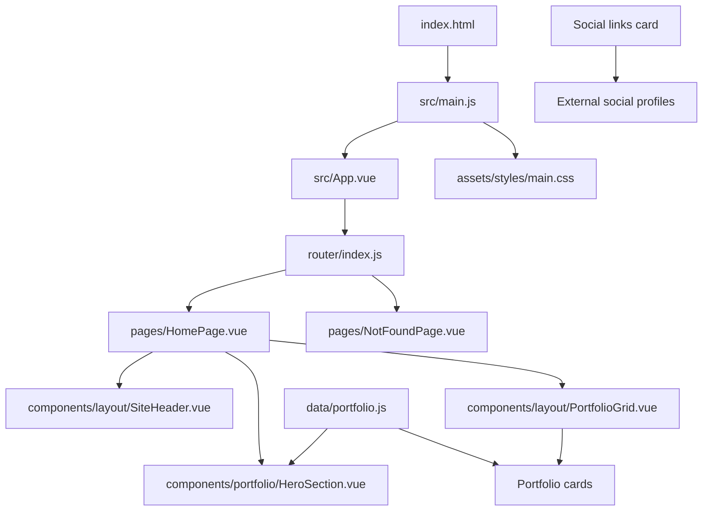

# Architecture

## Overview

This project is a client-rendered, single-page application built with Vue 3 and Vite. Vue Router renders the home portfolio and a not-found page. Portfolio copy and records live in one JavaScript data module; components present those records without a global store or backend.

## Application startup and routing

- `index.html` defines the document language, metadata, and `#app` mount point.
- `src/main.js` loads the Inter font, shared styles, router, and root component.
- `src/App.vue` renders the active route through `RouterView`.
- `src/router/index.js` maps `/` to the home page and unknown paths to the not-found page. Hash navigation scrolls to its target; a new route without a hash starts at the top.
- `src/pages/HomePage.vue` composes the site header, hero, and portfolio grid.

Static hosts must rewrite unknown paths to `/index.html` for history-mode routing. The included Nginx Docker configuration provides this fallback.

## Components and data

`src/components/` is grouped by responsibility:

- `common/` contains reusable presentation elements such as the icon list for skills, tools, and languages.
- `layout/` contains the page header and the grid that arranges the portfolio cards.
- `portfolio/` contains the hero and cards for the profile, summary, skills, experience, social links, and education.
- `pages/` contains route-level views.

`src/data/portfolio.js` is the single source for editable profile content. Each skill, tool, and language record contains a label and an icon key. `src/icons/portfolioIcons.js` maps those keys to Font Awesome definitions. Presentation styles and responsive breakpoints live in `src/assets/styles/main.css`.

## Social links and icons

Social profiles are records in `portfolio.socialLinks`, each with a label, URL, and icon key. `SocialLinksCard.vue` renders the records as external links. `src/icons/portfolioIcons.js` maps icon keys to Font Awesome definitions, so new platforms can be added by updating the data and icon registry without changing the card component.

## Resume file

`public/resume.pdf` is a placeholder path used by the download link. Replace it with the portfolio owner's actual resume PDF before deployment.

## Styling and assets

- Inter is self-hosted through `@fontsource-variable/inter`.
- `src/assets/styles/main.css` contains design tokens, base styles, component styles, and responsive breakpoints.
- The layout adapts from a four-column desktop grid to two columns on tablets and a single column on narrow screens.
- Reduced-motion preferences are respected for CSS transitions.

## Build, test, and runtime

- `npm run dev` starts Vite for local development.
- `npm run lint` checks JavaScript and Vue files with ESLint.
- `npm run build` creates the static production bundle in `dist/`.
- `npm run preview` serves the production bundle locally.
- `npm run test:e2e` starts Vite and runs the Playwright Chromium suite from `test/e2e/`.
- Playwright stores local artifacts in a temporary system folder and removes it after the run; it does not create a `test-results/` folder in the repository.
- Docker uses a Node build stage and an Nginx runtime stage.

## CI and release

GitHub Actions runs lint, build, and E2E tests on Windows and Linux across Node.js 22.18.0 and 24.12.0. Linux CI also audits production dependencies and builds the Docker image. A `v*` tag triggers the release workflow, which reruns lint, build, and E2E checks but does not publish or deploy the site.
